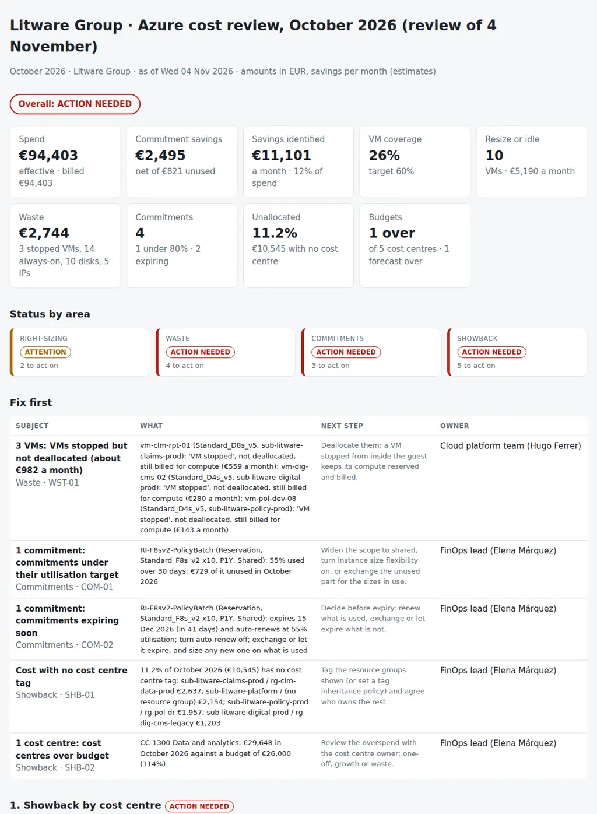

# Azure Cost Right-Sizing Review

The monthly review of an Azure bill: where the money went, what can be cut this month without hurting anyone, whether the reservations and savings plans are paying off, and which cost centre owns what. From the Azure Cost Management FOCUS export, the virtual machines with 30 days of Azure Monitor metrics, the managed disks, the public IP addresses, the reservations and savings plans, and the budget per cost centre, it puts together:

- **Right-sizing:** VMs whose CPU p95 and peak memory fit in one size down within the same family (`Standard_E16s_v5` → `Standard_E8s_v5`), with the projected use after the resize and the monthly saving; idle VMs.
- **Waste:** VMs stopped from the guest OS but not deallocated, still billed for compute; non-production VMs running around the clock with no schedule tag; managed disks unattached for weeks; public IPs associated with nothing.
- **Commitments:** reservations and savings plans under their utilisation target and the unused cost of the month; the ones expiring in the next 90 days with the renew or exchange decision, and those set to auto-renew at a low utilisation; the commitment coverage of the VMs and the steady pay-as-you-go VMs a commitment would cover.
- **Showback:** the month by cost centre against its budget, the month-end forecast of the current month, the cost with no cost centre tag and where it sits, the unit cost per cost centre (cost per claim, per policy, per active user) and the VMs missing the tags showback needs.

Eight CSVs, one JSON with the thresholds and one Python command give every area a status (**on track**, **attention** or **action needed**), a verdict for the month, the savings identified per month with how each one was worked out, and the pack for the monthly FinOps review: **what we spent, what we can cut, which commitments to renew, exchange or let expire, and who owns each line.**

Python 3.10+, standard library only. It runs with fictional demo data out of the box. A read-only PowerShell exporter for the Az modules is included.

It is the monthly companion of [01-finops-cloud-cost-dashboard](https://github.com/inigogonzalezgarcia/01-finops-cloud-cost-dashboard), which flags the week that looks wrong across AWS and Azure while it happens; this one decides, once a month, what to resize, delete, schedule and commit.



## Why

The bill tells you how much; it does not tell you what to do. In a typical month:

- three SQL Server VMs on `E16s_v5` peak at 15% CPU and use a third of their memory, because they were sized for a migration two years ago;
- a reporting VM was shut down from inside Windows three weeks ago and nobody deallocated it, so it is billed as if it were running;
- fourteen development and test VMs run every night and every weekend, with nobody using them;
- the disks and public IPs of a migration project finished in August are still there, unattached and untagged;
- a reservation bought for ten batch servers runs at 55% since half the batch moved to another platform, expires in six weeks and is set to auto-renew;
- a quarter of the VM spend is covered by a commitment, while forty production VMs run all month on pay-as-you-go;
- 11% of the bill has no cost centre tag, so nobody is asked about it;
- the data and analytics cost centre ends the month 14% over budget and is on course to do it again;
- and the cost per active user of the digital channels goes up 15% in one month because the users fell and the cost did not.

Cost Management knows the cost, Azure Monitor knows the use, the inventory knows the power state and the tags, the reservations know their utilisation, and finance knows the budgets. The monthly review joins them by resource and by cost centre. The rules are in `settings.json` and `azcostreview/checks.py`.

## What it checks

| Area | Code | Finding |
|---|---|---|
| Right-sizing | RS-01 | Running VMs with CPU p95 under `rs_cpu_p95` and peak memory use under `rs_mem_used` over 30 days, one size down in the same family, features and version; a saving of at least `rs_min_saving` a month. Flags VMs covered by a commitment, where the saving needs an exchange or other VMs to use the freed capacity |
| Right-sizing | RS-02 | Idle VMs: CPU p95 under `idle_cpu_p95` |
| Waste | WST-01 | VMs in the power state *VM stopped*: still allocated and billed for compute (critical) |
| Waste | WST-02 | Non-production VMs (`nonprod_envs`) running `always_on_share` of the hours with no schedule tag; the saving of an office-hours schedule (`office_hours_per_week`) |
| Waste | WST-03 | Managed disks unattached for `unattached_days` or more (from `LastOwnershipUpdateTime`) |
| Waste | WST-04 | Public IPs with no IP configuration and no NAT gateway |
| Commitments | COM-01 | Reservations and savings plans with a 30-day utilisation under `util_warning` (critical under `util_critical`), with the unused cost of the month |
| Commitments | COM-02 | Commitments expiring within `expiry_days`: critical when set to auto-renew under the utilisation target, a warning within `decision_days`, information otherwise |
| Commitments | COM-03 | VM coverage under `coverage_target`: the production VMs running `steady_share` of the hours on pay-as-you-go, their sizes, and the saving at `commitment_discount` (an upper estimate) |
| Showback | SHB-01 | Cost with no cost centre tag at `gap_warning` of the month (critical at `gap_critical`), by subscription and resource group |
| Showback | SHB-02, SHB-03 | Cost centres over budget in the month (critical over `budget_critical`); forecast over budget in the current month |
| Showback | SHB-04 | Unit cost up more than `unit_cost_warning` on the previous month |
| Showback | SHB-05 | VMs missing the cost centre, owner or env tag |

Every saving is an estimate per month at the run rate of the last seven days of the month: half the vCPUs in the same family is half the compute cost; an office-hours schedule is 60 of 168 hours; a commitment is 30% off the whole VM cost. They are there to rank the work, and the pack says to check them against Azure Advisor and the price sheet before deciding.

## Outputs

| File | What |
|---|---|
| `report.html` | Verdict, tiles (spend, commitment savings, savings identified, coverage, waste, unallocated, budgets), status by area, "Fix first", showback by cost centre against budget and forecast, unit cost, savings by kind, the resize and idle list with the projected use, waste, commitments with their decision, and all findings |
| `savings-pack.md` | The pack for the monthly FinOps review: headlines, where the money went by service and subscription, savings identified, the resize list with a decision column, waste, commitments, showback and budgets, unit cost, findings, actions, notes on how the savings are estimated, and sign-off |
| `rightsizing.csv` | Every VM with its size, power state, tags, CPU and memory, running share, cost, run rate, recommendation (resize, idle, deallocate, schedule, commit, keep) and saving |
| `waste.csv` | Every stopped VM, always-on VM, unattached disk and unassociated public IP with its owner, cost, saving and action |
| `commitments.csv` | Every reservation and savings plan with its utilisation, used and unused cost, savings against list price, expiry, auto-renew and decision |
| `showback.csv` | Every cost centre with its spend, share, budget, forecast, unit cost and the savings identified on its resources; next month's `effective_cost` for `units.csv` |
| `actions.csv`, `findings.csv` | The findings with owner, monthly saving and next step, ready for a tracker |

## Try it

```bash
git clone https://github.com/inigogonzalezgarcia/43-azure-cost-rightsizing.git
cd 43-azure-cost-rightsizing
python -m azcostreview demo
```

Open `output/report.html` and `output/savings-pack.md`.

### The demo data

The demo is a made-up insurance group, Litware Group, reviewed on Wednesday 4 November 2026 for October 2026, in euros:

- five subscriptions, one per cost centre: claims, policy administration, data and analytics, digital channels and the IT shared platform;
- 133 VMs (D, E, F and B series, Windows, Linux and SQL Server), 167 managed disks, 10 public IPs, 23 platform services (App Service, Azure SQL Database, Databricks, Cosmos DB, API Management, Azure Firewall, Log Analytics…), three reservations and one savings plan;
- a FOCUS export with 11,162 daily rows for October and the first three days of November (`sample_data/costs.csv`, 5 MB like a real export), 30 days of metrics, the budgets and the business units.

Everything is fictional, and the prices are round made-up figures, not Azure's price list. The problems are placed on purpose among the everyday ones:

- **Right-sizing:** three SQL Server VMs on `Standard_E16s_v5` at 14–16% CPU p95 and under a third of their memory, five web and ETL VMs on `Standard_D8s_v5` that fit in a `D4s_v5`, an old ETL server and a jump host idle: €5,190 a month.
- **Waste:** three VMs stopped but not deallocated, fourteen dev and test VMs on around the clock, nine disks and three public IPs left by a migration project that finished in August, another old disk and two IPs: €2,744 a month.
- **Commitments:** a reservation of ten `Standard_F8s_v2` at 55% utilisation, €729 unused in October, expiring on 15 December and set to auto-renew; a SQL Server reservation at 96% expiring in January; a VM coverage of 26%, with 41 steady production VMs on pay-as-you-go.
- **Showback:** 11.2% of the month (€10,545) with no cost centre tag, data and analytics at 114% of its budget and forecast at 118% for November, the cost per active user of the digital channels up 15%, and nine VMs missing tags.

The result: €94,403 spent in October, €2,495 saved by the commitments after €821 unused, **€11,101 a month of savings identified (12% of the month)**, and the verdict ACTION NEEDED.

## Use it with your own data

1. Set up, once, a Cost Management export of type *Cost and usage details (FOCUS)* to a storage account, and download the file of the month.
2. Export the rest (read-only):
   ```powershell
   .\scripts\Export-AzCostReviewData.ps1 -OutputFolder .\data -FocusExport .\downloads\part_0_0001.csv.gz
   ```
   - Az PowerShell with the Reader role: `Get-AzVM -Status` and `Get-AzVMSize` (vms.csv), `Get-AzMetric` on *Percentage CPU* and *Available Memory Bytes* at a one-hour grain (vm_metrics.csv), `Get-AzDisk` (disks.csv), `Get-AzPublicIpAddress` (public_ips.csv).
   - `Invoke-AzRestMethod` with GET on the Reservation - List All (`Microsoft.Capacity/reservations`) and Savings Plan - List All (`Microsoft.BillingBenefits/savingsPlans`) APIs for the utilisation aggregates, expiry and renew (commitments.csv).
   - The FOCUS file is copied as `costs.csv` or `costs.csv.gz`; the review reads both.
3. Add `budgets.csv` (finance) and, if you track one, `units.csv` (a business volume per cost centre). Adjust `data/settings.json`: the month, thresholds, tag names and owners ([docs/data-format.md](docs/data-format.md) has every column and setting).
4. Build the outputs:
   ```bash
   python -m azcostreview review data/ --month 2026-10
   ```

[docs/monthly-cost-review.md](docs/monthly-cost-review.md) has the monthly cycle, the agenda of the FinOps review, how to decide a resize or a commitment and how to record the decisions.

The exports contain resource names, owners and costs. Keep them inside your organisation:

- real files at the top level (`costs*.csv`, `costs*.csv.gz`, `part_*.csv`, `vms*.csv`, `vm_metrics*.csv`, `disks*.csv`, `public_ips*.csv`, `commitments*.csv`, `budgets*.csv`, `units*.csv`, `settings.json`, `data/`) and the `output/` folder are excluded from Git by `.gitignore`;
- only the fictional files in `sample_data/` are committed.

## Tests

```bash
pip install -r requirements-dev.txt
python -m pytest -q
```

GitHub Actions runs them on Python 3.10 and 3.12 on every push, then rebuilds the fictional sample data and the report screenshot from the simulator.

15 tests: loading the FOCUS export (plain and gzip, the tag formats) and the inventory, metrics, disks, public IPs and commitments; one size down for each kind of VM size; resize and idle candidates with the projected use and VMs covered by a commitment; VMs stopped but not deallocated and non-production VMs always on; unattached disks and unassociated public IPs; commitment utilisation, expiry with auto-renew, unused cost and savings against list price; coverage of steady VMs; the unallocated cost, budgets, forecast and unit cost; missing tags and custom tag names; status by area and overall; settings overrides; the pack and the CSVs; missing files; and the demo end to end (deterministic, all eight outputs).

## Next steps

- Run the exports and the review on the fourth day of every month and send each owner their lines of `rightsizing.csv` and `waste.csv`.
- Read the reservation and savings plan recommendations from the Cost Management Benefit Recommendations API to size the commitments instead of the flat estimate.
- Price the resizes from the Azure Retail Prices API instead of the vCPU ratio.
- Add the PaaS services that right-size the same way: App Service plans, Azure SQL Database and elastic pools.
- Read the FOCUS export straight from the storage account and keep a history of `showback.csv` for the unit cost trend over a year.

## Background

Built from my work on cloud and IT costs:

- Azure Cost Management, and applying the FinOps Framework: reservations, savings plans and commitments;
- optimising Azure costs with right-sizing and reservations;
- implementing showback and chargeback, and unit cost metrics;
- software asset management and licence and SaaS cost control, with Apptio and Flexera, TBM, FOCUS and GreenOps;
- business cases with ROI and measurable benefits, owning an IT budget, and estimating the cost and resources of projects;
- operating a hybrid AWS and Azure environment, with Azure Monitor and Log Analytics.

Written from scratch with fictional data; no employer data, systems or exports are used.

## Customisation and contact

Want this adapted to your environment? For example:

- your FOCUS export, your tag names and your cost centres;
- your thresholds, schedules and the way you price a resize or a commitment;
- other services to right-size, or AWS next to Azure;
- the pack in the format of your monthly FinOps review.

Get in touch:

- Website (contact form): [inigogonzalezgarcia.github.io](https://inigogonzalezgarcia.github.io/about.html#contacto)
- LinkedIn: [linkedin.com/in/igonzalez93](https://www.linkedin.com/in/igonzalez93)

## License

MIT
